# FilePizza 0.1.0 download failure paths

[Mermaid chart](download-legacy.mmd) · [Verification skill and local replay](../../.cursor/skills/verify-filepizza-transfer/SKILL.md)



The `0.1.0` release pinned by Freedom Skills uses a shared timer for all recipients. pstack found two shortest paths, each with three steps.

| Rule | Shortest path |
| --- | --- |
| Only the current download sends pieces. | A recipient starts a download, restarts while a read is pending, and receives a piece from the earlier download when its read completes. |
| Each recipient controls their own download. | A recipient receives the first piece, the next piece is scheduled, and a second recipient starts a download and clears the first recipient's timer. |

The model reached 21,985 states, so the chart draws the failure paths only. `NoDeadlock` held under the modeled bounds.

To regenerate in a scratch directory, copy `TransferLegacy.tla` and `TransferLegacy.cfg` from the verification skill and copy `download-legacy.view.mjs` from this directory. Use pstack at `5866df557357d005b3c0c9d3da0d9e739b4bdde3` and the same pinned TLC JAR as the verification skill.

```sh
"$PSTACK_STATECHART" TransferLegacy.tla --view download-legacy.view.mjs --out filepizza-download-legacy
```
