# Share availability and seeder shutdown

[Mermaid chart](seeder.mmd) · [Verification skill and local replay](../../.cursor/skills/verify-filepizza-seeder/SKILL.md)



pstack's `/statechart` reached 44 states and found that a share can be recorded as available after its peer has already failed. The shortest path creates the link, stalls the seeding manifest write, closes the peer after an error, records the error, and then commits the earlier seeding write. A local replay using the real manifest store reproduced the ordering.

The chart groups the initial startup steps into one visible state and keeps the steps on the failure path. It hides ordinary renewal steps that leave the link available. It follows one upload and assumes both manifest writes can complete.

To regenerate in a scratch directory, copy `Seeder.tla` and `Seeder.cfg` from the verification skill and copy `seeder.view.mjs` from this directory. Use pstack at `5866df557357d005b3c0c9d3da0d9e739b4bdde3` and the same pinned TLC JAR as the verification skill.

```sh
"$PSTACK_STATECHART" Seeder.tla --view seeder.view.mjs --out filepizza-seeder
```
